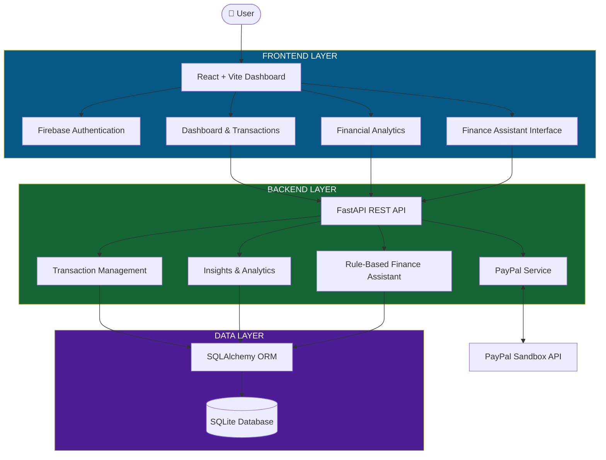
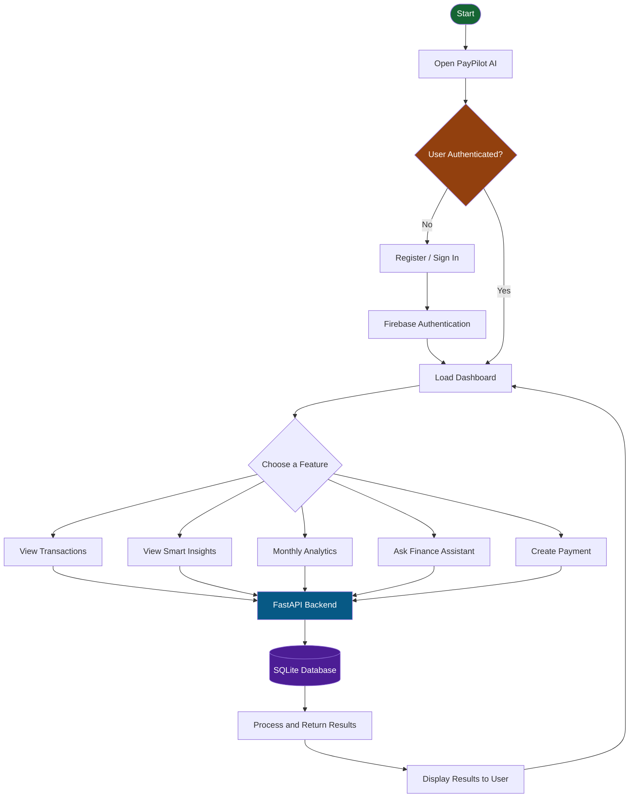
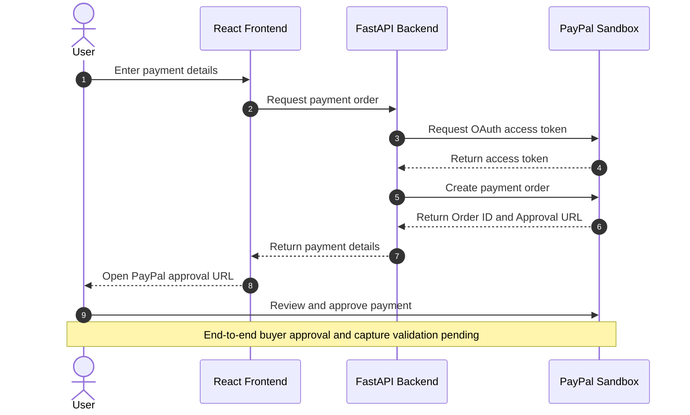
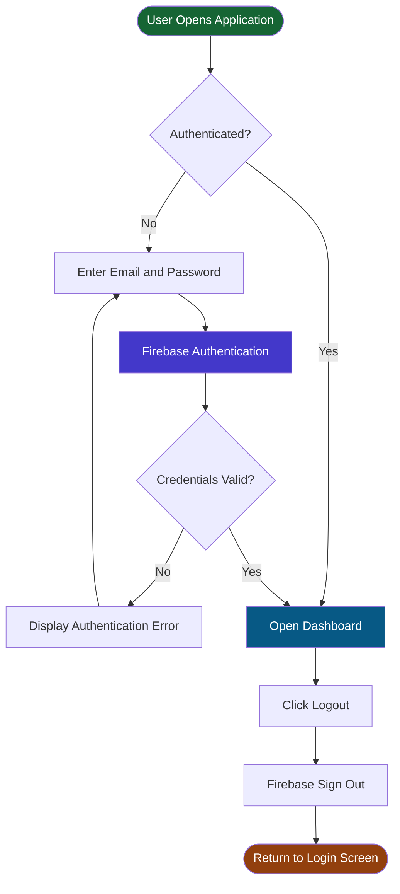
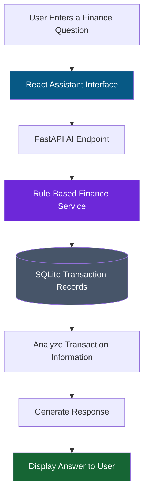

# 🚀 PayPilot AI – Intelligent Payment & Finance Copilot

<p align="center">
  <strong>Smarter Payments. Clearer Insights. Better Financial Decisions.</strong>
</p>

<p align="center">
  A full-stack payment and finance dashboard designed to monitor transactions, identify payment issues, and understand financial activity through a unified platform.
</p>

<p align="center">
  <a href="https://paypilot-ai-frontend.onrender.com">🌐 Live Demo</a> •
  <a href="https://github.com/jashikaraja05-pixel/PayPilot-AI">💻 GitHub Repository</a> •
  <a href="https://paypilot-ai-backend-yh47.onrender.com/docs">📚 API Documentation</a>
</p>

---

## 📌 1. Project Overview

PayPilot AI is an intelligent payment and finance dashboard that simplifies financial transaction monitoring and payment management.

It combines a modern React frontend, FastAPI backend, SQLite database, Firebase Authentication, and PayPal Sandbox integration.

The platform helps users monitor transactions, identify failed and pending payments, explore monthly financial analytics, and interact with a finance assistant.

## ✨ 2. Key Features

- 📊 **Financial Dashboard** – Centralized financial overview.
- 💳 **Transaction Management** – Monitor payment records and statuses.
- 🔐 **Firebase Authentication** – Email/password registration, login, and logout.
- 🤖 **Finance Assistant** – Rule-based answers using stored transaction information.
- 📈 **Monthly Analytics** – Explore financial activity over time.
- 🚨 **Smart Insights** – Identify failed and pending transaction patterns.
- 💰 **PayPal Integration** – Create payment orders using PayPal Sandbox.
- 🔎 **Transaction Search** – Search and filter transaction records.

## 🛠️ 3. Technology Stack

| Layer | Technologies |
|---|---|
| Frontend | React, Vite, JavaScript |
| UI & Charts | CSS, Lucide React, Recharts |
| Backend | Python, FastAPI |
| Database | SQLite, SQLAlchemy |
| Authentication | Firebase Authentication |
| Payment Gateway | PayPal Sandbox REST API |
| Deployment | Render |
| Version Control | Git, GitHub |

---

## 🏗️ 4. System Architecture

The following diagram represents the overall architecture of PayPilot AI.



## 🔄 5. Complete System Workflow

This workflow explains how users interact with the different modules of PayPilot AI.



## 💳 6. PayPal Payment Workflow

PayPilot AI integrates PayPal Sandbox REST APIs to create payment orders and provide an approval URL.



**Current Integration Status:**
- PayPal Sandbox OAuth authentication implemented and tested.
- Payment order creation implemented and tested.
- End-to-end payment capture validation is pending due to a Sandbox seller currency-acceptance issue.

## 🔐 7. Authentication Workflow

Firebase Authentication manages email/password registration and sign-in.



## 🧠 8. Finance Assistant Workflow

The current Finance Assistant uses rule-based logic and stored transaction information.



**Note:** This is a database-grounded, rule-based assistant. An external LLM API is not currently integrated.

---

## 📁 9. Project Structure

```text
PayPilot-AI/
│
├── backend/
│   ├── main.py
│   ├── ai_service.py
│   ├── database.py
│   ├── models.py
│   └── paypal_service.py
│
├── frontend/
│   ├── src/
│   │   ├── App.jsx
│   │   ├── App.css
│   │   ├── AuthScreen.jsx
│   │   ├── firebase.js
│   │   └── main.jsx
│   │
│   ├── package.json
│   └── vite.config.js
│
├── render.yaml
└── README.md
```

## ⚙️ 10. Installation & Setup

### Prerequisites

- Python 3.10+
- Node.js and npm
- Git
- Firebase Project
- PayPal Developer Sandbox Account

### Step 1: Clone Repository

```bash
git clone https://github.com/jashikaraja05-pixel/PayPilot-AI.git

cd PayPilot-AI
```

### Step 2: Backend Setup

```powershell
cd backend

python -m venv .venv

.\.venv\Scripts\Activate.ps1

pip install fastapi uvicorn sqlalchemy pydantic-settings python-dotenv httpx python-multipart
```

Configure PayPal Sandbox credentials in `backend/.env`:

```env
PAYPAL_CLIENT_ID=your_sandbox_client_id
PAYPAL_CLIENT_SECRET=your_sandbox_client_secret
PAYPAL_BASE_URL=https://api-m.sandbox.paypal.com
```

Start the backend:

```powershell
python -m uvicorn main:app --reload --host 127.0.0.1 --port 8000
```

Backend API:

`http://127.0.0.1:8000`

API Documentation:

`http://127.0.0.1:8000/docs`

### Step 3: Frontend Setup

Open another terminal:

```powershell
cd frontend

npm install
```

Create `frontend/.env` and configure:

```env
VITE_API_BASE_URL=http://127.0.0.1:8000

VITE_FIREBASE_API_KEY=your_firebase_api_key
VITE_FIREBASE_AUTH_DOMAIN=your_firebase_auth_domain
VITE_FIREBASE_PROJECT_ID=your_firebase_project_id
VITE_FIREBASE_STORAGE_BUCKET=your_firebase_storage_bucket
VITE_FIREBASE_MESSAGING_SENDER_ID=your_sender_id
VITE_FIREBASE_APP_ID=your_firebase_app_id
```

Enable Email/Password authentication in Firebase Console.

Start the frontend:

```powershell
npm run dev
```

Open:

`http://localhost:5173`

---

## 🌐 11. Live Deployment

| Component | URL |
|---|---|
| Frontend | https://paypilot-ai-frontend.onrender.com |
| Backend | https://paypilot-ai-backend-yh47.onrender.com |
| API Documentation | https://paypilot-ai-backend-yh47.onrender.com/docs |
| GitHub Repository | https://github.com/jashikaraja05-pixel/PayPilot-AI |

## 🔒 12. Security Notes

- Keep `.env` files private.
- Never commit PayPal client secrets.
- Use PayPal Sandbox credentials for testing.
- Configure Firebase authorized domains for deployed authentication.
- Backend Firebase token verification and user-level API authorization are future improvements.

## 🚀 13. Future Enhancements

- Complete end-to-end PayPal payment capture validation.
- Add backend Firebase token verification.
- Introduce user-specific transaction access.
- Integrate an external AI model for advanced financial assistance.
- Expand financial analytics and reporting.
- Improve notification and settings management.

---

<p align="center">
  <strong>PayPilot AI</strong>
  <br/>
  Making payment activity easier to understand.
  <br/><br/>
  Built with ❤️ using React, FastAPI, Firebase and PayPal Sandbox.
</p>
